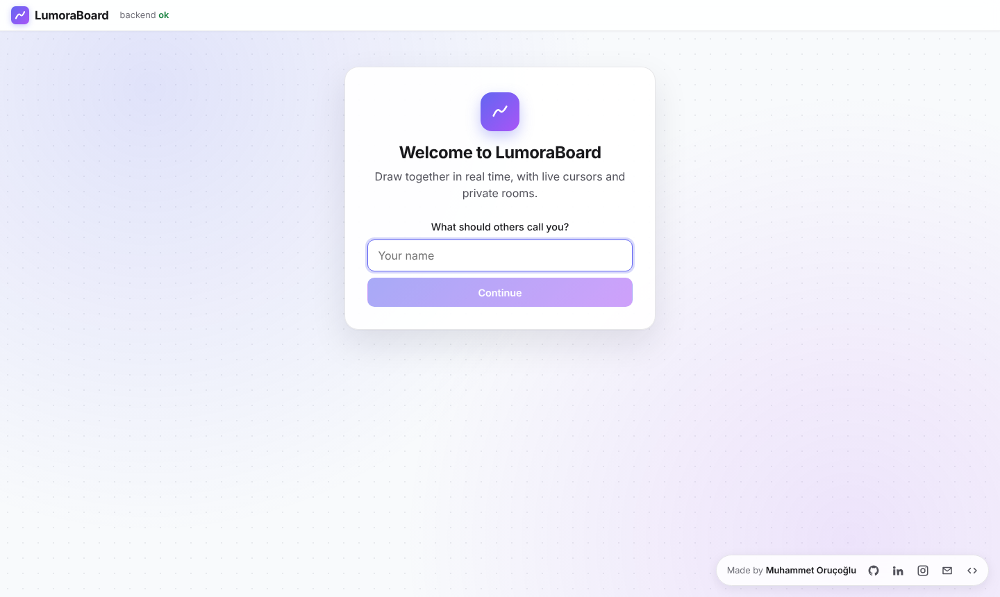
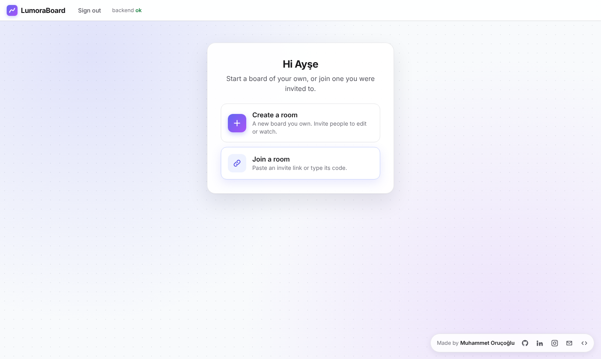
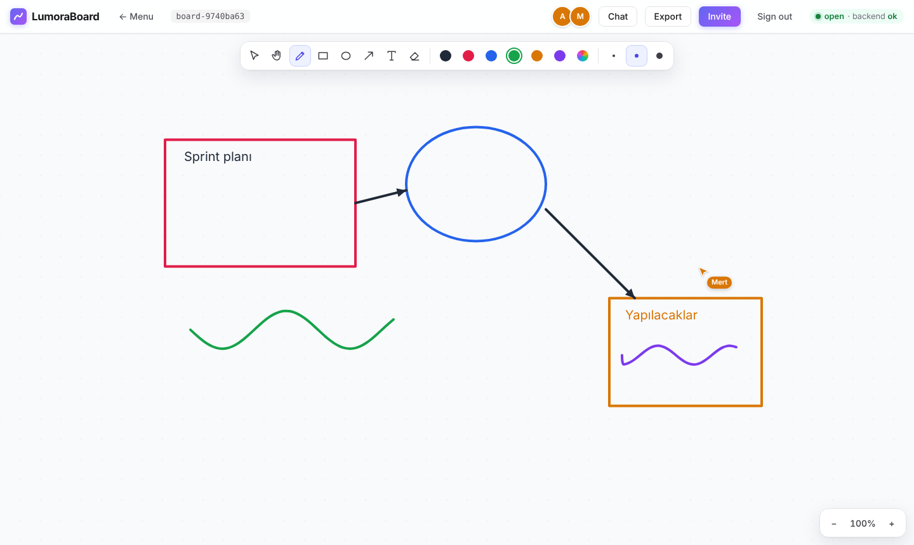
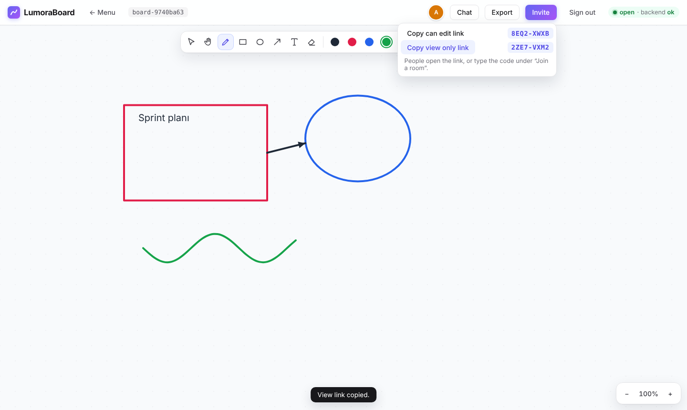
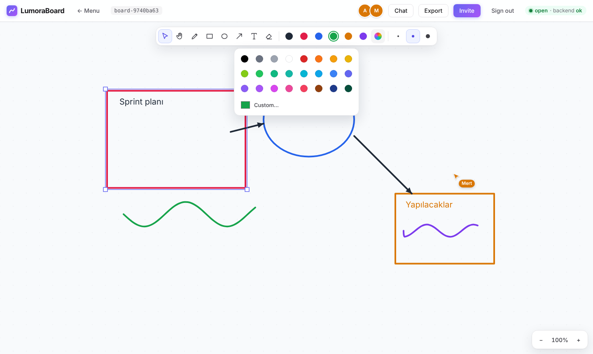
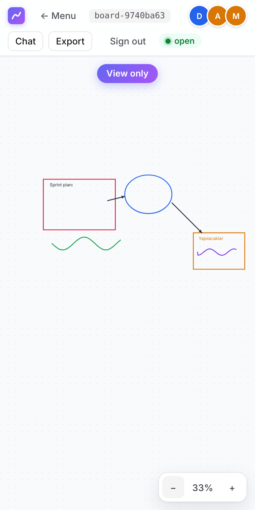

<div align="center">

# LumoraBoard

**Real-time collaborative whiteboard with live cursors, private rooms and invite links.**

**[Live demo →](https://p01--lumoraboard--bnwmr7y8bjlm.code.run)**

English · [Türkçe](README.tr.md)

<p>
  
  
  
  
  
  
  
</p>

</div>

A real-time collaborative whiteboard. Several people draw on the same board at once and see each other's strokes and cursors as they happen. The backend is Go with WebSockets, built around one goroutine per room; the frontend is SvelteKit.

> The demo runs on Northflank's free plan and does not go to sleep.

## Screenshots

<p align="center">
  
  
</p>

<p align="center">
  
</p>
<p align="center"><sub>Two people drawing on the same board; the other person's cursor shows with their name.</sub></p>

<p align="center">
  
  
</p>
<p align="center"><sub>Left: the invite menu. Right: resizing with corner handles and the color palette.</sub></p>

<p align="center">
  
</p>
<p align="center"><sub>A board opened on a phone with a "View only" invite: the viewer sees everything live but cannot change it.</sub></p>

## Features

- **Live drawing:** pen, rectangle, ellipse, arrow, text and an eraser, with a 24-color palette, a custom color and three stroke widths. Changes reach everyone in the room immediately.
- **Select and resize:** pick an object to move it or drag its corner handles to resize it. Pan and zoom the canvas.
- **Live cursors:** you see where everyone else is pointing, with their name.
- **Rooms with owners:** whoever creates a room owns it and decides who gets in.
- **Invites:** the owner shares an edit or view-only invite as a link or a short code such as `K7QM-2XRA`. Viewers watch live but cannot change anything.
- **Room chat:** every room has its own chat. A message can point at an object on the board.
- **Export and import:** PNG and SVG in the browser; high-resolution PNG, PDF and JSON backup as server jobs; import a JSON backup as a new board.
- **Survives restarts:** boards are stored in Postgres and a reconnecting client catches up on what it missed.
- **Scales out:** several server instances can share the load; each board lives on one instance at a time.

## How to use it

1. Open the site and enter your name.
2. Choose **Create a room** to start a board you own, or **Join a room** to enter one you were invited to.
3. As the owner, open **Invite** and copy a *can edit* or *view only* link. The code next to it works too.
4. The person you invite opens the link, or picks **Join a room** and pastes the link or types the code. They enter with the role the invite grants.

**← Menu** returns to the menu and **Sign out** starts over with a new name.

## How it works

The point of the project is concurrency, so the design keeps shared state to a minimum.

- **One goroutine per room (actor model).** Each room owns its board state and is the only code that touches it. Connections send it messages over channels, so there are no locks around the board.
- **Hub.** A single goroutine owns the table of rooms. Joining, creating and retiring rooms go through it, which makes the room lifecycle race-free.
- **Conflict resolution.** Every accepted change gets a sequence number from the room. For the same object the last change wins (LWW), and every client applies changes in the room's order, so all screens end up identical.
- **Backpressure.** Each connection has a bounded outbox. A client that cannot keep up is disconnected instead of slowing the room down. Cursor updates are lossy on purpose and are dropped first.
- **Write-behind persistence.** Accepted changes are batched and written to Postgres outside the room goroutine. A snapshot every 1000 changes keeps loading fast. If the database falls behind, the room pauses new changes until it catches up; accepted changes are never dropped.
- **Reconnects.** A client that reconnects says the last sequence number it saw. The room sends only what it missed, or a full snapshot if it is too far behind.
- **Several servers.** Each board is owned by one instance through a lease row in Postgres with an epoch. Clients that reach another instance are forwarded to the owner over a signed WebSocket. If the owner dies, another instance takes the board over within seconds, and the epoch stops a late old owner from overwriting it.
- **Export jobs.** Server exports run on a fixed pool of workers behind a bounded queue. A full queue answers 503 instead of piling up work.

## Tech stack

| Part | Technology |
|---|---|
| Backend | Go 1.25, `coder/websocket`, `pgx` |
| Frontend | SvelteKit (Svelte 5), TypeScript, Canvas |
| Database | PostgreSQL |
| Deployment | Docker (a single image), Northflank, Neon |
| Tests | `go test -race`, Vitest, svelte-check, golangci-lint |

## Project layout

| Path | What |
|---|---|
| `backend/cmd/server` | Entry point and configuration |
| `backend/internal/room` | Hub, room actors, persister |
| `backend/internal/ws` | WebSocket handler, forwarding between instances |
| `backend/internal/auth` | Sign-in, sessions, roles, invites |
| `backend/internal/cluster` | Room leases for several instances |
| `backend/internal/export` | Export and import jobs |
| `backend/internal/store` | Postgres and in-memory storage |
| `frontend/` | SvelteKit app |
| `docs/roadmap.md` | Development roadmap (Turkish) |

## Running locally

Requirements: Go 1.25+, Node 22+, Docker.

```sh
cd frontend && npm install && cd ..
make dev        # Postgres + backend on :8080 + frontend on :5173
make test       # go test -race, vitest, svelte-check
make lint       # go vet + golangci-lint
```

Then open http://localhost:5173. `make dev` turns on name-only sign-in.

## Configuration

| Variable | Meaning |
|---|---|
| `LUMORA_DATABASE_URL` | Postgres connection string. Without it, boards live in memory until the server restarts. |
| `LUMORA_PUBLIC_URL` | Where browsers reach the app. Default `http://localhost:5173`; on Render, `RENDER_EXTERNAL_URL` is used. |
| `LUMORA_DEV_LOGIN=1` | Sign in with just a name. |
| `LUMORA_GITHUB_CLIENT_ID`, `LUMORA_GITHUB_CLIENT_SECRET` | Enable GitHub sign-in (OAuth with PKCE). |
| `LUMORA_GOOGLE_CLIENT_ID`, `LUMORA_GOOGLE_CLIENT_SECRET` | Enable Google sign-in. |
| `LUMORA_GUESTS=view` | Let people without an invite watch boards read-only. |
| `LUMORA_ALLOWED_ORIGINS` | Comma-separated hosts allowed to open a WebSocket. Default: localhost and the public URL's host. |
| `LUMORA_CLUSTER_SECRET` | Turns on multi-server mode (at least 16 characters, same on every instance). |
| `LUMORA_ADVERTISE_URL`, `LUMORA_INSTANCE` | How other instances reach this one, and its name. |
| `PORT` / `LUMORA_ADDR` | Listen address. Default `:8080`. |

With no sign-in method configured, the server runs open: everyone can draw on every board.

## Deploying (Northflank + Neon)

The `Dockerfile` builds one image containing the Go server and the built frontend, served from the same origin.

1. Create a free Postgres database on [Neon](https://neon.tech) and copy its connection string.
2. On [Northflank](https://northflank.com), create a Combined service from this repository. Build type Dockerfile (`/Dockerfile`, context `/`), port `8080` (HTTP, public), health check `/healthz`.
3. Environment: `LUMORA_DATABASE_URL` (the Neon string), `LUMORA_DEV_LOGIN=1`, and `LUMORA_PUBLIC_URL` set to the service's public address. Northflank builds the image and redeploys on every push to `main`.

The `render.yaml` blueprint still works if you prefer Render.

`GET /healthz` reports health and `GET /version` the deployed commit.
